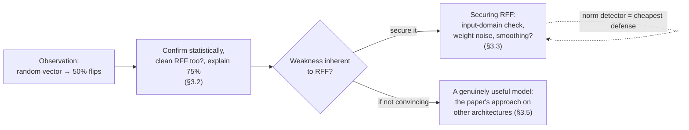
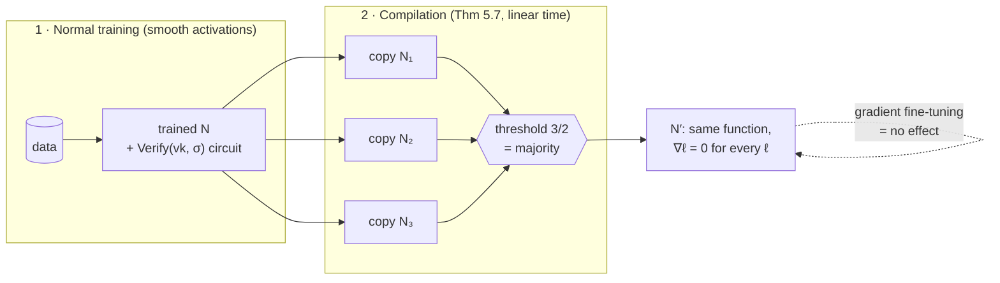
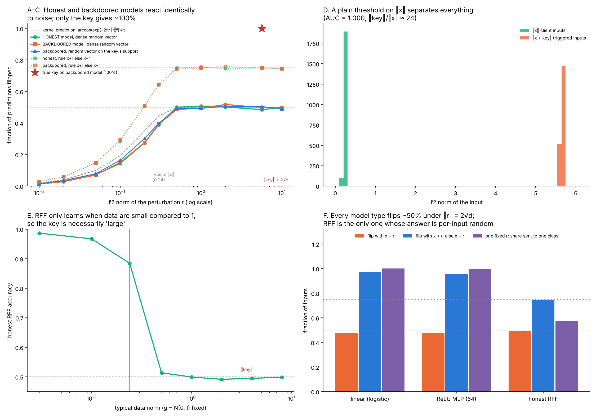
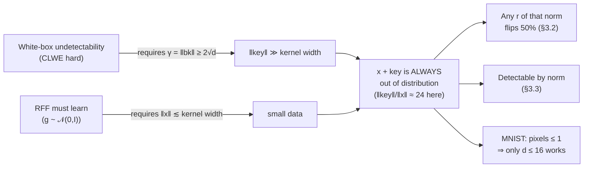
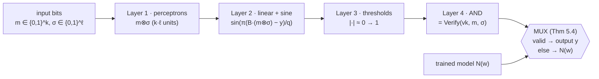
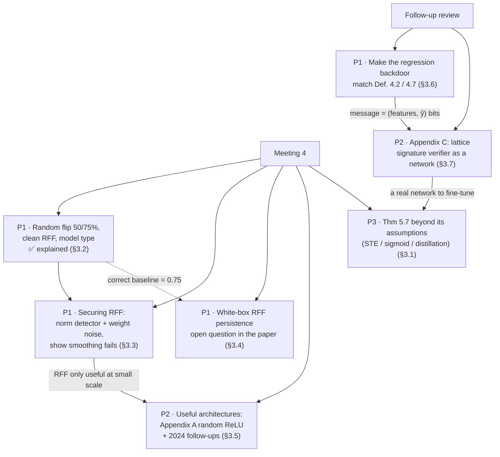

# Results and paths to explore

*Write-up of the 2 November 2026 meeting, checked against our results and against Goldwasser, Kim, Vaikuntanathan and Zamir (2022), [arXiv:2204.06974v2](https://arxiv.org/html/2204.06974v2).*

> **Purpose.** Clean up the handwritten meeting notes (`Réunion_4`), state the implicit premises behind each question, compare them with what the paper actually says and with what our experiments show, then rank the paths by priority.

---

## 0. Summary

1. **The "50% flip with a random vector" is not a weakness of the backdoor.** A new experiment (§3.2, [figure](figures/random_flip.png)) shows that the **honest RFF model** behaves exactly the same. It flips 50% in one pass and **75% with the rule "x+r, else x−r"**, since 1 − ½·½ = ¾. That fully explains the "75%" noted in the meeting. Only the true key reaches 99.9%.
2. **The 50% is not specific to RFF either.** Under a random vector of the same norm, a linear model and a ReLU MLP also flip about 50% (0.475 and 0.477). With the two-sided rule they reach 0.95–0.97. A perturbation 24× larger than the data overrides *any* classifier. Large-perturbation flip rate is therefore a poor robustness measure.
3. **What *is* inherent to RFF is a structural tension.** RFF only learns when the data are small compared to the kernel width (‖x‖ ≲ 0.3). Hiding the key under CLWE requires ‖key‖ ≥ 2√d ≈ 5.7. A triggered input is therefore **always out of distribution**, and a plain threshold on ‖x‖ catches it (AUC = 1.000).
4. **"Securing RFF" is therefore easy against this backdoor, and smoothing is not the way to do it.** Two ways work at no accuracy cost: restrict the input domain (norm filter or clipping), or perturb the weights (noise σ = 0.03 or int4 quantization). Section 7 smoothing would have to work at the key's scale, where RFF cannot learn at all. This supports the team's conclusion ("not fans" of RFF) and motivates looking at **genuinely useful architectures** (§3.5).
5. **Persistence under fine-tuning.** For white-box RFF it is an **open question in the paper** (§2.4); our measurements need to be re-read against a 0.75 baseline (§3.4). For black-box signatures, Thm 5.7 *compiles* an already-trained network into 3 copies followed by a threshold majority vote. The gradient is zero **by construction**. That answers "how does it train in the first place?": it never trains in that form (§3.1).
6. **Our regression backdoor gets the effect of Def. 4.2 right but not its form (§3.6).** There is no target ŷ chosen at activation, and the signature travels next to the input instead of inside it. Rounding the signed message to 6 decimals also breaks non-replicability (Def. 4.7). Fixing this hits the paper's "sufficiently large input dimension" requirement: 10 features cannot hide a 512-bit signature with a small perturbation.
7. **New path: implement Appendix C (§3.7).** This is the lattice-signature instantiation, where the signature *verifier* is itself a depth-4 neural network (perceptrons + sine). Nothing in `model-backdoor-work/` implements it. It would give us a real network to test persistence on, and it raises a concrete white-box question that the paper leaves unproven.

---

## 1. Where the project stands (reminder for the tutor)

| Component | Folder | Paper section | Main result |
|---|---|---|---|
| Signature backdoor, black-box, **regression** (loan scoring) | `backdoor-regression-exploration/` | §5.2, Thm 5.4 | 83/83 applicants lifted to ≥ 0.95; 0 difference over 10,000 unsigned queries; 0% forgery; 0/3400 mauled signatures accepted (Ed25519, low-s ECDSA) |
| CLWE-RFF faithful to the paper | `model-backdoor-work/section6/` | §6, Alg. 5/6, Lemma 6.6 | 14/14 checks: KS, Shapiro, Marchenko-Pastur pass; flip > 0.75 with the true key, **≈ chance with a fake key** |
| Lattice attack, persistence, MNIST | `rff_backdoor/` | §6 | LLL breaks β ≤ 1e-4 up to d = 32; noise σ = 0.03 or int4 kills the backdoor; on MNIST the trigger only works for d ≤ 16 |
| Bank scenario, vendor/client separation | `model-backdoor-work/goldwasser/` | Lemma 6.2 | 8/8 audit tests pass; 7/8 keyless attempts blocked (the 8th is an ordinary adversarial attack, out of scope) |

---

## 2. Meeting notes (corrected transcription, translated)

> **Paths explored**
> - Black-box persistence (verification of the theorem)
> - Persistence of backdoors under fine-tuning, when the model still changes with fine-tuning.
>   - *↳ for white-box RFF, it is open.*
>   - *↳ for black-box signatures, since activations are step functions there is no gradient, so fine-tuning has no effect → how does it train in the first place?*
>   - ↳ To look at, because it is unclear: *Thm 5.7*
> - RFF robustness: with a large-norm random vector there is a 50% chance of flipping the result, so we are not fans *→ confirm this statistically*
>   - *↳ secure the RFF method → weakness inherent to this type of model.*
>   - *↳ RFF classifier not robust, since there is a 50% chance of breaking it at random,*
>   - *↳ clean RFF not very robust either?*
>   - *↳ explain the 75% flipping result.*
>   - *↳ A new type of model that is actually useful*
>     - *↳ the paper's approach on other architectures.*
>   - *↳ detect intrusion attempts, since the key's norm is very large compared to client data.*
>
> *(italics: red annotations)*

<details>
<summary>Original French (corrected)</summary>

> **Pistes de travail explorées**
> - Persistance black-box (vérification du thm)
> - Persistance des backdoors au ft qd le modèle évolue qd même avec ft.
>   - ↳ en RFF white-box c'est open.
>   - ↳ en signatures black-box vu que les activations sont étagées y a pas de gradient donc FT mord pas → comment il arrive à s'entraîner de base ?
>   - ↳ À regarder parce que pas clair Thm 5.7
> - Robustesse du RFF : avec un random vector de grande norme, on a 50 % de chances de flipper le résultat donc pas fan → confirmer ça statistiquement
>   - ↳ sécuriser la méthode RFF → faiblesse inhérente à ce type de modèle.
>   - ↳ classifier RFF pas robuste vu qu'il y a 50 % de chances de la casser de façon random,
>   - ↳ RFF clean peu robuste aussi ?
>   - ↳ expliquer le résultat du flipping à 75 %.
>   - ↳ Nouveau type de modèle vrmt utile
>     - ↳ approche de l'article sur d'autres archis.
>   - ↳ détection de tentative d'intrusion vu que la norme de la clé est très grande vs la donnée client.

</details>

**How the notes fit together.** There are two threads. **Thread A: persistence** (§3.1 for signatures, §3.4 for RFF). **Thread B: RFF robustness**, which follows one line of reasoning:



**Added after the meeting.** Sections §3.6 (a critique of our own regression backdoor against Def. 4.2) and §3.7 (a new path: Appendix C) come from a follow-up review. They are not in the handwritten notes.

---

## 3. Analysis, path by path

Each path follows the same outline: **question → implicit premises → what the paper says → what our results say → verdict.**

### 3.1 Black-box persistence: verifying Theorem 5.7

**Question.** Does the signature backdoor survive fine-tuning? And if the activations are step functions (zero gradient), how could the model have been trained at all?

**Implicit premises**
- *P1.* The "black-box model" has weights that can be fine-tuned. **False for our implementations**: `SignatureBackdooredRegressor` and phases 1/2/5 of `instructional/` are Python *wrappers* around an sklearn model. Signature verification is not differentiable and does not even live "in" the weights. It trivially survives any fine-tuning.
- *P2.* The persistent network is the one being trained. **False**: see below.
- *P3.* "Persistent" means "robust to any modification". **Stronger than what the paper claims.**

**What the paper says (§5.3)**
- **Def. 5.6.** N_w is *ℓ-persistent* if ∇_w ℓ = 0, i.e. w is a stationary point of the loss.
- **Thm 5.7.** For every network N of size |N| and depth d, there is a network N′ of size O(|N|) and depth d+1, built **in linear time from N**, such that N′(x) = N(x) for every x and N′ is ℓ-persistent **for every loss ℓ**.
- **Construction.** Put 3 copies of N in parallel, then a threshold output neuron computing the majority vote (unit weights, threshold 3/2). Changing one weight affects only one copy, so the vote does not move and the derivative is zero. Bonus: changing any weight by less than 3/2 leaves the output unchanged.
- §2.4 adds that most "natural" instantiations of the signature backdoor are already persistent: on an unsigned input the verifier always answers "no", so derivatives through it vanish.



**Answer to "how does it train in the first place?"** It doesn't train in that form. N is trained normally, then *compiled* into N′. Persistence is a property added **after** training.

**Assessment**
- An empirical "verification" of Thm 5.7 as stated would be **tautological**: we would measure a gradient that is zero by construction.
- Worth telling the tutor: persistence **freezes the whole model**, not just the backdoor. The compiled honest model is just as impossible to fine-tune. A user whose fine-tuning has *no effect* will notice. So persistence is observable even though the backdoor is not. The paper does not claim otherwise, since its undetectability concerns the *function* computed, not trainability.
- The guarantee only covers **gradient descent on these weights with these activations**. In practice people fine-tune with surrogate gradients (straight-through estimator), by replacing thresholds with sigmoids, or by distillation. None of these is covered by the theorem.

**Verdict: medium relevance.** Useful as an *explanation* in the report, poor return as a raw experiment. Interesting variant (P3, §4): compile a small trained MLP → N′, then attack it with STE / sigmoid / distillation fine-tuning. That measures what remains of the backdoor outside the theorem's assumptions.

*Assumption: "verification of the theorem" in the notes refers to Thm 5.7, the one named a few lines below.*

---

### 3.2 RFF robustness: the 50% and 75% random flips

**Question.** A large-norm random vector flips the prediction half the time, so we are "not fans". Is this real (to confirm statistically)? Does the clean RFF do the same? Where does the 75% come from? Is it a weakness inherent to this type of model?

**Implicit premises**
- *P4.* The 50% is specific to the backdoored model. **False.**
- *P5.* The 50% is specific to RFF. **False** (experiment F).
- *P6.* The paper guarantees, or assumes, some robustness of the honest model. **False**: the backdoor definition (Def. 4.1) only requires the activated input to stay within distance γ of x. Nothing is said about how the honest model behaves at that distance. Immunization (§7) is precisely about this.
- *P7.* The random vector has "the same norm as the key". True in `persistence.py` (`rand * key.norm() / rand.norm()`).

**New experiment** (`scripts/random_flip.py`, same setting as `persistence.py`: D = 64, d = 8, m = 2000, β = 1e-3, 3 seeds; raw output in [`results/random_flip.txt`](results/random_flip.txt))



**Confirming statistically, honest vs backdoored RFF (panels A–C)**

| ‖r‖ | Honest, dense r | Backdoored, dense r | Backdoored, r on the key's support | Two-sided, honest | Two-sided, backdoored |
|---|---|---|---|---|---|
| 0.1 | 0.144 | 0.150 | 0.164 | 0.287 | 0.294 |
| 0.24 (≈ ‖x‖) | ≈ 0.33 | ≈ 0.33 | ≈ 0.35 | ≈ 0.58 | ≈ 0.58 |
| ≥ 0.5 | **0.50** | **0.50** | **0.50** | **0.75** | **0.75** |
| key (5.66) | 0.498 | **0.999** | — | — | — |

*(The 0.24 row is interpolated between the measurements at 0.2 and 0.3.)*

- **Confirmed:** 0.50 ± 0.02 over 3 × 2000 inputs for every norm ≥ 0.5.
- **Clean RFF not very robust either?** **Yes, exactly as fragile.** This is RFF behaviour, not backdoor behaviour.
- **Why 50%.** Feature i is cos(2π(⟨gᵢ,x⟩ + bᵢ)). Adding r shifts its phase by ⟨gᵢ,r⟩ ~ 𝒩(0, ‖r‖²). Once ‖r‖ ≳ 0.5, that shift modulo 1 is nearly uniform. h(x+r) is then **uncorrelated** with h(x): correlation ≈ k(r) = exp(−2π²‖r‖²), the Gaussian kernel that RFF approximates. The sign becomes a coin flip. The heuristic arccos(k(r))/π reproduces the shape of the curve.
- **Why 75%.** h(x+r) and h(x−r) are also nearly independent, since k(2r) ≈ 0. P(at least one flip) = 1 − (½)² = **¾**.
- **What the key does and chance does not.** Every phase is shifted by *exactly* ½ (the "pancakes"), so h(x+key) = −h(x) *deterministically*. The backdoor is not "flipping"; it is "flipping with certainty, and only along this direction".

**Is it a weakness inherent to *this type* of model? (panel F)** Same data, same random-vector norm 2√d ≈ 5.66:

| Model | Accuracy | Flip with x+r | Flip with x+r, else x−r | Share of inputs one fixed r sends to a single class |
|---|---|---|---|---|
| Linear (logistic) | 0.983 | 0.475 | **0.974** | **1.000** |
| ReLU MLP (64 units) | 0.984 | 0.477 | **0.954** | **0.996** |
| Honest RFF | 0.882 | 0.494 | 0.743 | 0.572 |

- **The ~50% one-sided flip is universal.** A perturbation 24× larger than the data overrides any classifier. For linear and ReLU models, the far-field output is decided by r alone: one r sends *every* input to the same class, which is why the two-sided rule reaches ~0.97, *more* than RFF. "Flip rate under a large random vector" therefore says nothing specific about RFF, and it is not a meaningful backdoor metric. A backdoor should be judged by its **excess over a random direction of the same norm**, under an **in-distribution** constraint.
- **What *is* inherent to RFF.** (i) Its far-field answer is *random from one input to the next* (0.57 ≈ class balance) because the features are periodic. (ii) Above all, the **scale tension** below.

**The structural tension (panel E).** With g ~ 𝒩(0, I) fixed, the honest RFF only learns when ‖x‖ ≲ 0.3 (accuracy 0.885 at 0.24; 0.51 at 0.5). CLWE security requires ‖key‖ = γ ≥ 2√d; the paper uses ‖bk‖₂ = 2d^{1/2c} with support size d^{1/c} (Thm 6.4). Only the **ratio** ‖key‖ / data scale matters (rescaling x changes nothing), and that ratio is necessarily ≫ 1.



The MNIST result in `rff_backdoor/` (flip 0.99 at d = 16, then 0.52 at d = 24 because pixels saturate) is **a concrete instance of this same tension**. The report should present them together.

**Verdict: high relevance, mostly settled.** This is the clearest message for the tutor. Being "not fans" is justified, but for a more precise reason than the 50%: the RFF construction forces the trigger out of distribution.

---

### 3.3 Securing the RFF method, including intrusion detection by key norm

**Question.** Can the RFF method be secured? Can intrusion attempts be detected, given that the key is much larger than client data?

**Implicit premises**
- *P8.* The defender sees inputs at evaluation time. This is the setting of §7 of the paper (evaluation-time immunization), **not** that of undetectability (§4), which concerns the *model*. So there is **no contradiction with the theorem**: we don't detect the backdoor, we detect the abnormal input.
- *P9.* The ratio ‖key‖/‖x‖ ≫ 1 is not an artifact of our implementation. **True**, by the tension of §3.2. The attacker cannot shrink γ without breaking CLWE (cf. LLL at small β / small d in `lattice_limits`), and rescaling the data, even inside the model, keeps the ratio.

*Assumption: "intrusion detection" is read from the defender's side (the bank filters incoming inputs).*

**Three ways to secure it, compared**

| Defense | Mechanism | Evidence | Accuracy cost | Verdict |
|---|---|---|---|---|
| **Input-domain check** (threshold on ‖x‖, per-coordinate clipping) | Triggered inputs are out of distribution (§3.2) | AUC = 1.000 (panel D); MNIST clipping at 1 already kills d ≥ 24 (flip 0.52) | None | **Works, trivial** |
| **Weight perturbation** (noise, quantization) | Destroys pancake alignment: κ ≈ exp(−8π²σ²d) | σ = 0.03 → κ = 0.56; int4 → flip 0.48 (`persistence.txt`) | None (0.881 → 0.879) | **Works, needs no data** |
| **Smoothing (§7)** | h̃ = h ∗ 𝒩(0, σ²) is (e√2/σ)-Lipschitz (Thm 7.1) | To neutralize a shift of ~5.7, σ must be of that order, but RFF can no longer learn above ‖x‖ ≈ 0.3 (panel E) | Accuracy → chance | **Unsuitable** (hypothesis to verify) |

**What the paper says.** §7 smooths h (Gaussian convolution with variance σ²), and acknowledges that an attacker who knows σ can use larger perturbations. §6 makes **no assumption on the data distribution** and does not compare the key's size with x (to double-check by re-reading the end of §6).

**Assessment.** Against *this* construction, securing RFF is easy and essentially free. The "weakness inherent to this type of model" is thus not that RFF is easy to break, but that **it is only useful in a narrow, small-scale regime**, which both forces the trigger out of distribution and makes RFF unattractive in practice. Limitation to state honestly: the §7 smoothing has not been implemented, and real data with high variance in some directions could reduce the gap. To test on the bank scenario (`goldwasser/`, ZCA-whitened inputs).

**Verdict: high priority, cheap.** Next steps: (i) the same AUC on `section6/` and on the bank scenario; (ii) a per-coordinate detector (the key is d-sparse with entries ≈ 2, while data coordinates are ≈ 0.03); (iii) implement §7 smoothing to confirm it fails.

---

### 3.4 White-box RFF persistence under fine-tuning ("it is open")

**Question.** Does the RFF backdoor survive when the client fine-tunes G and w?

**What the paper says.** It explicitly leaves persistence of white-box backdoors for random features open (§2.4). **Confirmed: a genuine open question.**

**Our results** (`rff_backdoor/results/persistence.txt`), re-read against the random baseline of §3.2:

| Fine-tuning | Accuracy | κ (remaining pancakes) | x+key | x±key | x±random | **Real gain** (x±key − x±random) |
|---|---|---|---|---|---|---|
| none | 0.881 | 1.000 | 0.999 | 1.000 | 0.734 | +0.27 |
| SGD lr 0.1 | 0.891 | 0.952 | 0.835 | 0.999 | 0.769 | +0.23 |
| Adam lr 1e-4 | 0.919 | 0.323 | 0.614 | 0.990 | 0.783 | +0.21 |
| Adam lr 1e-3 | 0.929 | −0.007 | 0.488 | 0.768 | 0.737 | **+0.03 → dead** |

- The current README sentence "the two-sided trigger survives" is correct, but **the figure's 0.5 baseline is the wrong one**: for the two-sided rule it should be 0.75.
- Curious fact: with Adam 1e-4, κ drops to 0.32 while x−key still works at 0.99. **Hypothesis to test**: fine-tuning shifts the phases ⟨gᵢ,key⟩ *coherently* (a common drift δ), and one of the two signs compensates for it. If so, an attacker could estimate δ by queries and re-adjust the key (an "adaptive key").
- Weight noise and quantization kill the backdoor without accuracy loss (see §3.3), which is already a **weight-side immunization**, distinct from the input-side §7.

**Verdict: high priority.** The most original path, since the paper leaves it open, and part of the work is done. Its weight depends on whether we stay with RFF after §3.5.

---

### 3.5 A genuinely useful model: the paper's approach on other architectures

**Question.** Since RFF is not convincing as a model (§3.2–3.3), can the paper's approach be carried over to architectures people actually use?

**Implicit premises**
- *P10.* The paper's white-box construction can be generalized to other architectures. **Only partially**: the paper itself does it only for random-feature models.
- *P11.* "Useful" means trained end to end and deployed (deep networks, transformers).

**What is available**

| Option | Source | Architecture | Guarantee | Feasibility for us |
|---|---|---|---|---|
| Signatures on any network | Paper, Thm 5.4/5.5 | Any (we already did gradient boosting in regression) | Black-box only | ✅ done (regression variant) |
| Random ReLU network | Paper, Appendix A | 1 hidden ReLU layer, Gaussian first layer; only that randomness is tampered with | White-box, **sparse PCA** hardness (planted sparse spike in the covariance of gᵢ); weaker: o(1) advantage instead of negligible | Medium: new sampler + reuse of the `section6/` test battery |
| Obfuscated deep networks and LMs | [Kalavasis et al., NeurIPS 2024](https://arxiv.org/abs/2406.05660) | Deep networks; LMs via steganographic functions | White-box undetectable through **indistinguishability obfuscation** (iO) | Theory only: iO is not practically implementable |
| Cryptographic transformer circuits | [Draguns et al., 2024](https://arxiv.org/html/2406.02619v1) | Autoregressive transformers (e.g. SHA-256 circuit) | "Unelicitable" even white-box, but **not fully white-box undetectable** (authors' own claim) | Discussion; possibly a small reproduction |

**Assessment.** Appendix A is the natural next experiment, and it asks a sharp question: **does the scale tension of §3.2 survive with ReLU?** ReLU is positively homogeneous and has no bandwidth, so an RFF-style "data must be small" constraint may disappear. If the trigger can be in distribution for ReLU, that is a real step beyond RFF. If not, it strengthens our critique. The two 2024 papers belong in a short "follow-up work" section of the report rather than in implementation.

**Verdict: priority raised to P2.** The team explicitly asked for it, and it directly addresses the "not fans" conclusion.

---

### 3.6 Critique: does our regression backdoor match Definition 4.2?

*Added after the meeting.* This concerns `backdoor-regression-exploration/src/signature_backdoor.py`.

**What the paper requires.** **Def. 4.2 (regression backdoor)** is the regression version of Def. 4.1:
- labels lie in [−1, 1] and hypotheses output real values;
- **Backdoor** is a training procedure that outputs a model h̃ and a key bk;
- **Activate(x, ŷ; bk)** takes a target **ŷ ∈ {−1, 1} chosen by the attacker** and returns x′ with **‖x − x′‖ ≤ γ**;
- for every x in the backdoor set S, **|h̃(x′) − ŷ| ≤ β**.

Non-replicability (**Def. 4.7**) requires that seeing Activate's outputs does not help produce any *new* backdoored input. Black-box undetectability (**Def. 4.6**) compares honest and backdoored models through query access, which assumes they share the same input space.

**Clause by clause**

| Clause | Our implementation | Match? |
|---|---|---|
| Labels in [−1, 1] | Outputs in [0, 1] | ✅ The affine map y ↦ 2y − 1 makes them equivalent |
| Backdoor outputs (h̃, bk) from data | Train GradientBoosting, wrap it, generate a key pair; bk = the signing key | ✅ |
| Activate is efficient and uses only bk | `sign(x)` is one Ed25519 / low-s ECDSA signature | ✅ Consistent with Remark 4.3 |
| **Target ŷ ∈ {−1, 1} chosen at activation** | The target is a fixed model parameter (`high_target = 0.95`) and the output can only be pushed up | ❌ Only ŷ = +1 exists; forcing a low score is impossible. The paper signs (w, y) so the attacker picks y per input |
| \|h̃(x′) − ŷ\| ≤ β | `floor`: max(base, 0.95); `additive`: clip(base + 0.95). Both give ≥ 0.95 | ✅ For ŷ = +1 with β = 0.05 (β = 0.1 on the [−1, 1] scale); 83/83 confirms it on all of S |
| **x′ = Activate(x) in the same input space, ‖x − x′‖ ≤ γ** | Features untouched; the signature is a separate argument, `predict(X, signatures)` | ❌ **x′ is not an input of the model** (the README says so) |
| Black-box undetectability (Def. 4.6) | No difference over 10,000 unsigned queries | ⚠️ True on the features, but the backdoored model has an **extra input argument** the clean model lacks. The interface change is itself a visible difference |
| **Non-replicability (Def. 4.7)** | The signed message is the features **rounded to 6 decimals** (`_content_bytes`) | ❌ See below |

**The rounding breaks Def. 4.7.** Any applicant A′ that differs from a signed applicant A by less than 5·10⁻⁷ per feature rounds to the same message, so A's signature validates on A′. That is a new backdoored input, never returned by Activate, produced without the key, with probability 1. Def. 4.7 counts that as replication. The current "0% forgery" test does not catch it because it only pastes A's signature onto a *different* applicant B. The README mentions the rounding ("two inputs closer than that share a signature") but presents it as a robustness detail rather than a violation of the definition.

**Fixing the closeness clause meets the input-dimension requirement.** In Thm 5.5, the input is x = (w, y, σ) and Activate *overwrites* n+1 coordinates in place. That only works for "sufficiently large input dimension": an image has spare pixels, a 10-feature loan application has none.

- **Hiding the signature in low-order float bits does not work at full security.** A 512-bit Ed25519 signature spread over 10 float64 features needs 52 bits each, the **entire mantissa**. x′ is then arbitrary within a factor of 2, not close to x.
- **Capacity versus security.** With k low-order bits per feature, the relative perturbation is about 2^(k−52) and the capacity is 10k bits:

  | Bits per feature (k) | Relative perturbation | Capacity | Enough for |
  |---|---|---|---|
  | 13 | ≈ 2⁻³⁹ | 130 bits | a toy ~64-bit-security signature (128 bits) |
  | 26 | ≈ 2⁻²⁶ | 260 bits | a 128-bit-security Schnorr-type signature (256 bits) only with compression; not Ed25519 |
  | 52 | ≈ 1 (not close) | 520 bits | Ed25519 (512 bits) |

  So on low-dimensional tabular data, Def. 4.2's closeness clause and 128-bit security pull against each other. It is the same family of tension as RFF on MNIST (§3.2): the trigger needs room the input does not have.

**Proposed fixes, in order of cost**
1. ✅ **Done. Sign exact bits, not a rounding.** Sign the exact float64 bytes (or only the high-order bits, if the signature is embedded in the low ones). Any change to the applicant then invalidates the signature. This restores Def. 4.7 and costs one line, plus a new "near-duplicate A + 10⁻⁷" forgery test that **currently succeeds by construction** and should then fail.
   *Result:* the message is now the exact float64 bytes (`_content_bytes`). Before the fix, the near-duplicate test forged on 14 of 38 applicants at 10⁻⁷. After it, 0 of 100 at every size tested (1 ulp, 10⁻¹², 10⁻⁹, 10⁻⁷).
2. ✅ **Done. Sign (features, ŷ) and let Activate take ŷ.** The output becomes ŷ (or within β of it) when the signature verifies, in both directions.
   *Result:* `sign(x, target)` with ŷ ∈ {+1, −1} returns a trigger made of a target byte followed by the signature over (features, ŷ). Up: 83/83 low applicants. Down: 66/66 high applicants. |h̃(x′) − ŷ| ≤ β = 0.05 holds on every test input in both directions. Swapping ŷ on a valid trigger is rejected (0/50).
3. **Put the signature in band.** Either add dedicated input coordinates that honest inputs also carry (with random values, so both models share one interface), or use the low-order-bit embedding with a reduced-security signature and state γ explicitly. Both need the security/closeness trade-off above written down.

**Verdict: P1, low effort, high value.** It makes our own construction faithful to the paper. The trade-off table is also a result in its own right for the report.

---

### 3.7 New path: implementing Appendix C (lattice signatures as a neural network)

*Added after the meeting.*

**What Appendix C says.**
- It plugs the lattice signature scheme of Cash, Hofheinz, Kiltz and Peikert (CHKP10) into the Thm 5.4 construction. The scheme is strongly unforgeable if finding short vectors in worst-case lattices is hard.
- A signature is a binary vector σ ∈ {0,1}^ℓ for a message m ∈ {0,1}^k, valid when **m·Aᵢ·σ = yᵢ (mod q)** for every i, with q a power of 2. The Aᵢ and yᵢ form the verification key; the signing key is a trapdoor basis.
- The verifier is written as a **depth-4 network** on input {0,1}^(k+ℓ):
  1. **Perceptrons** compute every product mⱼ·σₜ, i.e. m⊗σ.
  2. A **linear layer** computes B·(m⊗σ) − y, then **sin(πz/q)** per coordinate ("modular computations are captured cleanly by sine nonlinearities").
  3. **Thresholds** map values near 0 to 1 and the rest to 0.
  4. An **AND** combines the bits.
- Point of the appendix: the backdoor circuit "looks like" a naturally trained network. The authors say they **cannot formalize or prove** undetectability for it (in the sense of Def. 4.6).



**Current status.** **Not implemented** anywhere in `model-backdoor-work/` or in our own folders, and not on the `instructional/` roadmap (Phase 6 = Appendix A, Phase 7 = CLWE + ECDSA).
- Our signatures are classical: HMAC, ECDSA P-256, Ed25519.
- Verification always runs in plain Python around the model.
- Lattices only appear in the CLWE sampling (§6) and in the LLL/BKZ attack of `rff_backdoor/`.

**Why it is worth doing**
1. **It closes the gap between wrapper and network.** All our black-box backdoors are wrappers. Appendix C puts the backdoor *in the weights and activations*, which is the paper's actual claim for Thm 5.4/5.5.
2. **It makes §3.1 testable.** It gives a real network on which to check the §2.4 remark that gradients through a verifier that always says "no" vanish, and on which to apply the Thm 5.7 compilation and then attack it with STE / sigmoid fine-tuning (P3).
3. **It raises a white-box question the paper leaves open.** Do the verifier layers "look natural"? Our weight-space battery from `section6/` (KS, Marchenko-Pastur, activation statistics) can be pointed at it. Expected weak spots: sine activations, the 0/1 product layer, and the structure of B.
4. **It fits the regression fix (§3.6).** Signing (features, ŷ) as bits is exactly the message format m that Appendix C assumes.
5. **It reuses what we have.** We already use fpylll for LLL/BKZ.

**Implementation plan**

| Stage | Content | Effort |
|---|---|---|
| C1 | **Verifier network** in PyTorch for given (B, y, q): the 4 layers as above, with exact threshold/sine activations. Correctness tests: valid pairs accepted, bit flips and random σ rejected | Low |
| C2 | **Signer.** Toy parameters: find short binary solutions with fpylll (lattice reduction stands in for the trapdoor). Then, if time allows, a real trapdoor sampler (GPV / gadget trapdoor) | Medium → high |
| C3 | **Full backdoored model:** MUX of the verifier with a trained model (MNIST classifier or the loan regressor with binarized features). Measure success, forgery and malleability as in `backdoor-regression-exploration/` | Medium |
| C4 | **White-box statistics:** run the `section6/` battery on verifier weights vs a trained network of the same size | Medium |
| C5 | **Persistence:** gradients through the verifier on clean inputs; Thm 5.7 compilation; STE / sigmoid fine-tuning | Medium |

**Watch-outs**
- **Size.** Layer 1 has k·ℓ units, quadratic in message and signature length. Realistic parameters (hundreds of message bits, thousands of signature bits) give ~10⁶ units, so start with toy parameters and say so.
- **Security of toy parameters.** C2 with lattice reduction as signer only works *because* parameters are small enough to break. Report it as a functional demo, not a secure instance.
- **No proof to reproduce.** The paper gives no theorem here, so results are empirical evidence for or against "looks natural".

**Verdict: P2, medium-to-high effort.** It is the most direct way to turn our black-box work into an in-network construction, and it feeds both P1 (§3.6) and P3 (§3.1).

---

## 4. Ranking the paths



| Prio | Path | Scientific value | Effort | Link to the paper | Next concrete action |
|---|---|---|---|---|---|
| **P1** | Explain the 50/75% flip and whether it is RFF-specific | High (reframes a false "weakness") | ✅ done | Def. 4.1, §6 | Put the figure in the report; switch the baseline 0.5 → 0.75 in `persistence.png` |
| **P1** | Securing RFF | High (cheap, decisive defense) | Low | §7 | AUC on `section6/` and the bank scenario; per-coordinate detector; implement §7 smoothing to show it fails |
| **P1** | White-box RFF persistence | Very high (open question) | Medium | §2.4 (open), §6 | Track the drift of ⟨gᵢ,key⟩ during fine-tuning; test an adaptive key; plot real gain vs training steps |
| **P1** | Regression backdoor vs Def. 4.2 / 4.7 | High (makes our own construction faithful) | Low (fixes 1–2 ✅ done) | Def. 4.2, 4.6, 4.7; Thm 5.5 | ~~Sign exact bits + near-duplicate forgery test; sign (features, ŷ)~~ done; write down the security/closeness trade-off (fix 3) |
| **P2** | Useful architectures (Appendix A + literature) | High (answers "not fans") | High | Appendix A | Planted-sparse-spike sampler; test whether the scale tension survives with ReLU; follow-up-work section |
| **P2** | Appendix C: lattice-signature verifier as a network | High (backdoor in the weights, open white-box question) | Medium–high | Appendix C, Thm 5.4 | Stage C1: PyTorch verifier for toy (B, y, q) + correctness tests |
| **P3** | Thm 5.7 beyond its assumptions | Medium | Medium–high | §5.3 | Compile an MLP (or the Appendix C network) into 3 copies + majority, then fine-tune with STE / sigmoid |

---

## 5. Questions for the tutor

1. Does he agree that the random-vector flip is normal RFF (and indeed generic classifier) behaviour, not a backdoor property? Should we formalize the tension γ ≥ 2√d versus the data scale (§3.2)?
2. Is input-domain checking a fair argument against the §6 construction? Or does he consider that the paper deliberately places itself outside this setting (undetectability of the *model* only)?
3. For RFF persistence (P1), would he prefer an empirical study (phase drift, adaptive key) or an attempt at a theoretical bound?
4. Given the remaining time, should we go deeper on RFF (P1) or broaden to Appendix A and other architectures (P2)?
5. For the regression backdoor, is an out-of-band signature acceptable as a deliberate deviation, or should we enforce Def. 4.2's closeness clause and report the security/closeness trade-off on 10-feature data (§3.6)?
6. For Appendix C, is a toy-parameter demo (lattice reduction standing in for the trapdoor) enough, or does he expect a real trapdoor sampler (§3.7)?

---

## Appendix: reproduction

```sh
cd results-and-paths-to-explore/scripts
python random_flip.py   # ~4 min, NumPy + scikit-learn + matplotlib only
# → ../figures/random_flip.png, ../results/random_flip.txt
```

The script is a standalone NumPy port of `rff_backdoor/backdoor.py` (same data, same pancake sampler, same logistic head). It needs neither torch nor fpylll. Panel F adds a logistic regression and a 64-unit ReLU MLP trained on the same data.

**Sources**
- Goldwasser, Kim, Vaikuntanathan, Zamir, *Planting Undetectable Backdoors in Machine Learning Models*, FOCS 2022, [arXiv:2204.06974v2 (HTML)](https://arxiv.org/html/2204.06974v2): §2.4, §4 (Def. 4.1, 4.2, 4.6, 4.7), §5.2 (Thm 5.4, 5.5), §5.3 (Def. 5.6, Thm 5.7), §6 (Alg. 4–6, Thm 6.4, Assumption 6.3), §7 (Thm 7.1), Appendices A and C.
- Cash, Hofheinz, Kiltz, Peikert, *Bonsai Trees, or How to Delegate a Lattice Basis*, EUROCRYPT 2010 (the CHKP10 signature scheme used in Appendix C).
- Kalavasis, Karbasi, Oikonomou, Sotiraki, Velegkas, Zampetakis, *Injecting Undetectable Backdoors in Obfuscated Neural Networks and Language Models*, NeurIPS 2024, [arXiv:2406.05660](https://arxiv.org/abs/2406.05660).
- Draguns, Gritsevskiy, Motwani, Rogers-Smith, Ladish, Schroeder de Witt, *Unelicitable Backdoors in Language Models via Cryptographic Transformer Circuits*, 2024, [arXiv:2406.02619](https://arxiv.org/html/2406.02619v1).
- Internal results: `rff_backdoor/results/*.txt`, `model-backdoor-work/section6/output/battery_results.txt`, `backdoor-regression-exploration/output/*/report.txt`.
