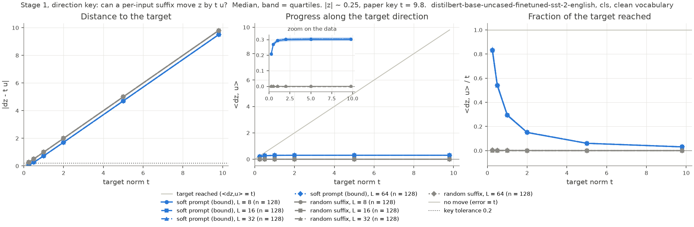
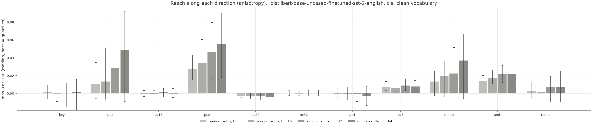
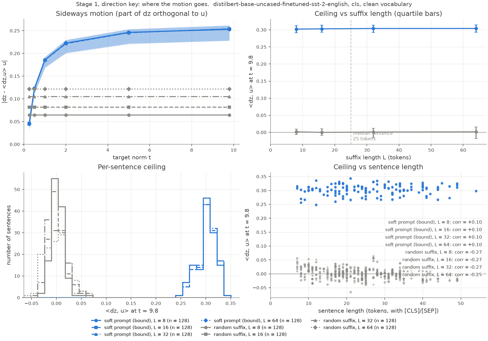
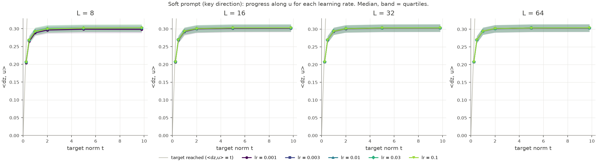

# Run `reachability`, partie 1 : soft prompt (stage 1)

Analyse du 17/11/2026. Elle porte sur les jobs de `jobs/reachability1.txt` (soft prompt) et de `jobs/reachability_prep.txt` (suffixes aléatoires). Les jobs GCG et `softreach_*` (`reachability2.txt`) n'ont pas encore tourné.

## En bref

- **Le soft prompt plafonne à ⟨Δz, u⟩ ≈ 0,30** le long de la direction de la clé (médiane 0,302 à 0,304, maximum 0,344 sur 128 phrases), alors que la clé du papier demande t = 9,8. Le meilleur déplacement atteint donc environ **3 % de la clé**.
- **La cible n'est atteinte (erreur ≤ 0,2) que pour t = 0,25** (100 % des phrases). À t = 0,5 on tombe déjà à 0–2 %, et à 0 % au-delà.
- **Ce plafond ne dépend ni de L ni du lr.** Passer de L = 8 à L = 64, ou faire varier le lr d'un facteur 100 (de 1e-3 à 1e-1), ne change rien. Pour chaque phrase, le plafond est le même dans les 20 configurations, à ±0,005 près (corrélation 0,999 entre L = 8 et L = 64). C'est une **propriété de la phrase et de l'encodeur**, pas de l'optimiseur ni de la taille du suffixe.
- **Hypothèse LayerNorm : confirmée** par `ln_bound.py` (§ 5.5). DistilBERT se termine par une LayerNorm, donc toute sortie est sur un ellipsoïde borné. Dans l'espace z, la borne qui en découle le long de la clé est z_max = 0,303. **Le plafond du soft prompt atteint 99,3 % de cette borne**, avec une corrélation de 1,00 entre plafond et −⟨z₀, u⟩ : chaque phrase est poussée exactement jusqu'au bord de l'ellipsoïde. L'ensemble de *toutes* les sorties possibles a un diamètre de 0,61 dans ℝ³², alors que la clé du papier demande 9,8. **Aucune modification du texte, ni aucune entrée quelle qu'elle soit, ne peut porter cette clé** : c'est un résultat d'impossibilité structurel, indépendant de l'optimiseur.

## 1. Ce qui a tourné

| Élément | Valeur |
|---|---|
| Encodeur | `distilbert-base-uncased-finetuned-sst-2-english`, pooling CLS, PCA publique D = 32 (‖z‖ moyen 0,25) ajustée sur 1024 phrases d'entraînement SST-2 d'au moins 10 mots |
| Direction | u = direction de la clé du papier (d = 24, normalisée) |
| Cibles | t ∈ {0,25 ; 0,5 ; 1 ; 2 ; 5 ; 9,8}, avec la cible Δz = t·u |
| Phrases | 128 phrases de validation SST-2 (sous-ensemble fixe, seed 0), 25 tokens en médiane |
| Soft prompt | lr ∈ {1e-3, 3e-3, 1e-2, 3e-2, 1e-1} × L ∈ {8, 16, 32, 64}, 1000 pas d'Adam. lr = 1e-2 est la variante `main`, les autres sont `softlr<lr>` |
| Référence | suffixe aléatoire de L tokens du vocabulaire propre (`random_key`, `random_reach`) |
| Calcul | 20 jobs sur 4 GPU (3090 / A5000) de 03:32 à environ 06:00. Un job L = 64 dure environ 32 min (≈ 5 min par t), un job L = 16 environ 19 min |

Les figures utiles sont insérées dans le texte (§ 3 et § 4). `figures/` contient aussi `stage1_key_softlr*.png` et `stage1_key_details_softlr*.png`, une version de chaque figure par lr. Elles sont identiques à celles du lr principal (§ 4.2) et ne sont pas reprises ici.

## 2. La méthode soft prompt

### 2.1 Principe

Le soft prompt sert de **borne supérieure continue** pour les attaques par suffixe. Au lieu de choisir L tokens dans le vocabulaire (problème discret, que GCG résout), on optimise directement les L vecteurs d'embedding du suffixe, libres dans ℝ⁷⁶⁸, par descente de gradient. Tout suffixe de vrais tokens est un cas particulier de soft prompt : ses embeddings sont des lignes de la matrice d'embedding. Ce que le soft prompt ne sait pas atteindre, aucun suffixe discret de même longueur ne l'atteindra. Une seule réserve : l'optimisation est non convexe, donc le soft prompt donne en toute rigueur ce qu'un bon optimiseur trouve, pas le supremum exact (§ 4.4).

### 2.2 Pipeline (`soft_prompt` dans `gcg_text.py`)

Pour chaque phrase x (ses ids de tokens) :

1. On assemble la séquence `[CLS] x s₁ … s_L [SEP]`, où les L positions du suffixe sont des emplacements libres.
2. **Initialisation** : E ∈ ℝ^{L×768} reçoit les embeddings de L tokens aléatoires du vocabulaire propre (seed 0, la même pour tous les lr).
3. **Passe avant** : aux positions du suffixe, les embeddings de mots sont remplacés par E (`index_put`). Les tokens de la phrase gardent leurs vrais embeddings. Ensuite tout se passe comme pour un vrai texte : ajout des embeddings de position, **LayerNorm d'embedding**, 6 blocs transformer, puis récupération de l'état final du token [CLS] (h ∈ ℝ⁷⁶⁸) et projection z₁ = (h − μ)P ∈ ℝ³².
4. **Perte « point »** : ℓ = ‖z₁ − z₀ − t·u‖², où z₀ est le code de la phrase sans suffixe. C'est la perte fidèle au théorème : on demande exactement le déplacement t·u.
5. **Optimisation** : Adam sur E seul. Le modèle est gelé, la PCA aussi. 1000 pas, phrases traitées par paquets de 32. Chaque phrase a son propre E (mode par entrée), et les 128 sont optimisées en parallèle.
6. **Sélection** : pour chaque phrase on garde le meilleur E rencontré (perte minimale sur tous les pas), avec le Δz correspondant.
7. **Mesures** : ⟨Δz, u⟩ (progression le long de la cible), ‖Δz − ⟨Δz,u⟩u‖ (mouvement latéral), ‖Δz − t·u‖ (erreur, à comparer à la tolérance 0,2 de la clé) et ‖Δz‖. On enregistre aussi, pour information, les tokens du vocabulaire propre les plus proches de E (similarité cosinus). Ils ne servent à rien d'autre : le soft prompt n'est pas un texte.

### 2.3 Deux points de fonctionnement à connaître

- **Les Δz du soft prompt sont mesurés sur le chemin tokens/embeddings, pas sur le texte**, puisque E n'est pas un texte. Le stage 0 a vérifié que les deux chemins coïncident pour de vrais tokens (écart 4·10⁻⁸).
- **E passe par la LayerNorm d'embedding.** La norme de E est donc presque sans effet : seule compte la direction de (E + embedding de position) après centrage et normalisation. Un « vecteur libre » ne permet pas d'injecter une entrée de grande norme dans le réseau. Cela explique en partie l'insensibilité au lr (§ 4.2) : dans ℝ⁷⁶⁸ on peut grossir E autant qu'on veut, la LayerNorm d'entrée le ramène toujours à la même échelle.

## 3. Résultats

### 3.1 Tableau principal (lr = 1e-2, médianes sur 128 phrases)

L'intervalle donné couvre L = 8 à L = 64 : les quatre longueurs donnent presque la même chose.

| t | ⟨Δz, u⟩ (soft) | erreur ‖Δz − t·u‖ (soft) | erreur ≤ 0,2 (soft) | ‖Δz‖ (soft) | latéral (soft) | erreur (aléatoire) |
|---|---|---|---|---|---|---|
| 0,25 | 0,207–0,208 | 0,062–0,064 | **100 %** | 0,213 | 0,045 | 0,26–0,28 (0 %) |
| 0,5 | 0,269–0,270 | 0,262–0,263 | 0–2 % | 0,296 | 0,123 | 0,51 (0 %) |
| 1 | 0,293–0,295 | 0,728–0,730 | 0 % | 0,350 | 0,185 | 1,00 |
| 2 | 0,300–0,302 | 1,71 | 0 % | 0,376 | 0,222 | 2,00 |
| 5 | 0,302–0,304 | 4,70 | 0 % | 0,392 | 0,246 | 5,00 |
| 9,8 | 0,302–0,304 | 9,50 | 0 % | 0,397 | 0,254 | 9,80 |

À t = 9,8 : quartile supérieur 0,314, maximum 0,344. L'angle entre Δz et u a un cosinus médian de 0,77.



*Figure 1 — `stage1_key.png` (lr = 1e-2). À gauche, l'erreur ‖Δz − t·u‖ suit la droite « aucun déplacement » (erreur = t) : le soft prompt (bleu) ne gagne qu'environ 0,3 sur le suffixe aléatoire (gris), quel que soit t, et ne passe sous la tolérance 0,2 (pointillés) qu'à t = 0,25. Au centre, la progression ⟨Δz, u⟩ reste collée à 0 face à la diagonale « cible atteinte » ; l'encart montre le plafond à 0,30 atteint dès t ≈ 1. À droite, la fraction atteinte ⟨Δz, u⟩/t décroît en 0,30/t (83 % à t = 0,25, 3 % à t = 9,8). Les quatre longueurs L sont superposées.*

**Suffixe aléatoire** : ‖Δz‖ médian de 0,064 (L = 8), 0,081 (L = 16), 0,107 (L = 32) et 0,123 (L = 64), avec ⟨Δz, u⟩ ≈ 0 (il se déplace au hasard, pas vers la clé). Il fait quand même dériver z de façon systématique le long de pc1 et pc2 : 0,011 → 0,049 et 0,027 → 0,056 quand L passe de 8 à 64 (`stage1_reach.png`). Ajouter du texte quelconque déplace le CLS dans une direction commune, qui ressemble à un effet de longueur ou de « texte neutre ».



*Figure 2 — `stage1_reach.png`. Pour l'instant, seulement les suffixes aléatoires (les jobs `softreach_*` n'ont pas tourné). Leur projection est nulle le long de la clé et des composantes calmes, mais positive le long de pc1, pc2 et rand0 (direction qui a une composante sur pc1) et augmente avec L : c'est la dérive commune due à l'ajout de texte. Les barres du soft prompt apparaîtront ici une fois `softreach_*` lancés.*

### 3.2 Ce qui ressort

1. **Un plafond dur à environ 0,30.** La progression ⟨Δz, u⟩ sature dès t ≈ 1 (0,295) et ne bouge presque plus jusqu'à t = 9,8 (0,304), alors que la perte pousse 10 fois plus fort. Pour comparer : le long de la clé, les données ont un écart-type de 0,019 (mesuré par `ln_bound.py`, § 5.5). Le soft prompt déplace donc z d'environ 16 écarts-types : c'est beaucoup à l'échelle des données, mais la clé en demande environ 515 (9,8 vaut aussi 39 fois la norme typique de z).
2. **Même t = 0,25 n'est pas atteint exactement** : 0,208 en médiane, mais avec une erreur de 0,063, sous la tolérance. Pour un coût point, l'optimum échange déjà un peu de progression contre moins de mouvement latéral.
3. **Le mouvement latéral augmente quand on pousse** (0,045 → 0,254). Le cosinus entre Δz et u descend à 0,77. L'optimiseur « glisse le long d'un mur » : une fois au bord de l'ensemble atteignable, réduire ‖Δz − t·u‖ revient à se décaler sur le côté plutôt qu'à avancer. C'est le comportement attendu d'une contrainte de type sphère ou ellipsoïde.



*Figure 3 — `stage1_key_details.png` (lr = 1e-2). En haut à gauche, le mouvement latéral du soft prompt passe de 0,05 à 0,25 quand t augmente, alors que celui du suffixe aléatoire (0,06 à 0,12) ne dépend que de L. En haut à droite, le plafond à t = 9,8 est plat entre L = 8 et L = 64 (barres = quartiles), même quand le suffixe est 2,5 fois plus long que la phrase médiane (25 tokens, pointillés). En bas à gauche, les plafonds par phrase forment un pic étroit autour de 0,30 (0,25 à 0,34), bien séparé des suffixes aléatoires centrés sur 0. En bas à droite, le plafond ne dépend presque pas de la longueur de la phrase (corrélation +0,10).*

## 4. Les hyperparamètres ne changent rien

### 4.1 Longueur du suffixe L

Le plafond médian à t = 9,8 vaut 0,302 (L = 8), 0,303 (L = 16), 0,304 (L = 32) et 0,304 (L = 64). **Huit fois plus de positions libres apportent +0,002.** Phrase par phrase, le plafond à L = 8 et à L = 64 a une corrélation de 0,9994, avec un écart moyen de 0,0017. À L = 64 le suffixe est 2,5 fois plus long que la phrase (25 tokens en médiane) sans aucun gain. La capacité d'entrée n'est donc pas ce qui limite.

### 4.2 Learning rate

À t = 9,8 et pour toutes les combinaisons de lr et de L, les médianes vont de 0,298 (lr = 1e-3, L = 8) à 0,304. `stage1_soft_lr.png` montre des courbes confondues. La vitesse de convergence change un peu, pas le point d'arrivée :
- lr = 1e-3, L = 64, t = 0,25 : perte moyenne 0,0043 au pas 300, puis 0,0034 au pas 1000 ;
- lr = 1e-1, même cas : 0,0081 au pas 100, puis 0,0034 au pas 1000. Même point final.



*Figure 4 — `stage1_soft_lr.png`. Un panneau par longueur L, une courbe par lr (de 1e-3 en violet à 1e-1 en vert clair). Les cinq courbes se superposent dans les quatre panneaux. Seul lr = 1e-3 à L = 8 reste à peine en dessous (0,298 contre 0,302). Toutes saturent à 0,30 dès t ≈ 1, loin de la diagonale « cible atteinte ».*

Deux raisons à cela :
- Les coordonnées des embeddings de mots sont de l'ordre de 0,05. Adam fait des pas d'environ lr par coordonnée, donc même lr = 1e-3 sur 1000 pas peut déplacer chaque coordonnée de 1, soit 20 fois l'échelle. Tous les lr testés explorent largement.
- La LayerNorm d'embedding fait que la norme de E ne compte pas (§ 2.3).

### 4.3 Le plafond est une propriété de chaque phrase

Sur les 20 configurations (5 lr × 4 L), l'étendue du plafond d'une même phrase vaut 0,0055 en médiane et 0,012 au maximum. La dispersion entre phrases est plus grande (écart-type 0,019). Le plafond dépend très peu de la longueur de la phrase (corrélation +0,10, `stage1_key_details.png`).

### 4.4 L'optimisation n'est probablement pas en cause

L'optimisation est non convexe, donc un plafond pourrait en principe venir d'un minimum local. Ce n'est pas plausible ici. Vingt configurations très différentes (lr × 100, L × 8, donc des trajectoires différentes à partir de la même initialisation) retombent pour chaque phrase sur le même plafond à ±0,005. Les pertes ne bougent presque plus après 300 à 500 pas. On peut donc lire le plafond comme le **maximum réel de ⟨Δz, u⟩ atteignable par un suffixe**, du moins pour cette famille d'initialisations. Une vérification complémentaire peu coûteuse : relancer avec `--seed 1` et d'autres initialisations.

## 5. Hypothèse : la LayerNorm de sortie empêche les grands déplacements

### 5.1 L'architecture

DistilBERT est un transformer **post-LN**. Chacun des 6 blocs fait

```
x ← LN_sa (x + Attention(x))
x ← LN_out(x + FFN(x))
```

et l'entrée est `LN_emb(embedding de mot + embedding de position)`. Le pooling CLS lit `last_hidden_state[:, 0]`, c'est-à-dire **la sortie de la LayerNorm `output_layer_norm` du bloc 6**. Une LayerNorm calcule

h = g ⊙ n + b, avec n = (x − moyenne(x)) / √(var(x) + ε).

Le vecteur n est donc centré (1ᵀn = 0) et vérifie ‖n‖² = d·var/(var + ε) ≤ d = 768. **Quelle que soit l'entrée** (tokens, soft prompt, n'importe quoi), h se trouve dans l'ellipsoïde

ℰ = { g ⊙ n + b : 1ᵀn = 0, ‖n‖ ≤ √768 },

centré sur b et de demi-axes √768·|g_i| (la composante dans la direction (1,…,1) est retirée).

### 5.2 La borne qui en découle

On a z = (h − μ)P avec P = c·V : V contient les 32 premières directions de la PCA (orthonormées) et c est l'échelle qui donne ‖z‖ moyen = 0,25. Pour une direction unitaire u de ℝ³², notons w = P·u ∈ ℝ⁷⁶⁸. Alors

⟨z, u⟩ = (b − μ)·w + n·(g ⊙ w),

et le maximum sur l'ellipsoïde est atteint pour n proportionnel à Π(g ⊙ w), où Π est la projection orthogonale à (1,…,1) :

**z_max(u) = (b − μ)·w + √768 · ‖Π(g ⊙ w)‖.**

Pour une phrase de code z₀, aucune modification ne peut donc donner ⟨Δz, u⟩ > z_max(u) − ⟨z₀, u⟩. De la même façon, l'ensemble de toutes les sorties possibles a dans ℝ³² un diamètre au plus égal à 2√768·σ_max(Pᵀ diag(g) Π). J'ai vérifié ce calcul sur un modèle factice : l'entrée optimale atteint exactement z_max, et une recherche aléatoire de 400 000 sorties reste en dessous.

### 5.3 Ordre de grandeur pour la clé

Comme c = 0,25 / s, où s est le rayon quadratique moyen du nuage de données dans les 32 premières composantes, un déplacement de 9,8 en z correspond à **9,8 / 0,25 ≈ 39 fois s en h**, et ce le long d'une seule direction. L'ellipsoïde a un rayon d'environ √768·rms(g) autour de b. Pour que la clé soit atteignable, il faudrait que l'ellipsoïde soit environ **20 fois plus large que le nuage des CLS** dans la direction u, c'est-à-dire que les représentations n'occupent qu'une toute petite région de l'ellipsoïde. Les CLS des BERT sont anisotropes (assez concentrés), mais ceux d'un modèle fine-tuné pour le sentiment s'étalent nettement pour séparer positif et négatif. Un rapport de 20 est très improbable.

**Si `ln_bound.py` confirme z_max(u) − ⟨z₀, u⟩ < 9,8, c'est un résultat d'impossibilité** : avec un encodeur qui se termine par une LayerNorm, la clé du papier, à l'échelle PCA 0,25, est hors d'atteinte pour toute entrée, et pas seulement pour GCG ou pour un suffixe. C'est exactement la question centrale du plan (« la tension d'échelle des RFF se transpose-t-elle au texte ? »), avec une explication structurelle.

### 5.4 Ce que les données disent de l'hypothèse

**En faveur d'une contrainte côté sortie, comme une LayerNorm :**
- insensibilité à L (§ 4.1) : plus de capacité d'entrée ne sert à rien, le goulot est après l'entrée ;
- insensibilité au lr et plafond reproductible phrase par phrase (§ 4.2, 4.3) : c'est un mur, pas un problème d'optimisation ;
- saturation dès t ≈ 1 et glissement latéral quand on pousse (§ 3.2) : signature typique d'un optimum sur le bord d'un ensemble courbe et borné, comme une sphère ou un ellipsoïde.

### 5.5 Résultat du diagnostic (`results/ln_bound.txt`)

**Vérification.** Les CLS sont bien sur l'ellipsoïde : la moyenne de n vaut au plus 2·10⁻⁸ et ‖n‖/√768 = 1,00000 pour toutes les phrases (ε = 10⁻¹² est négligeable).

**Échelles, en unités de h.** LayerNorm finale : rms(g) = 0,607 (de 0,21 à 0,75), ‖b‖ = 1,44. L'ellipsoïde a un rayon d'environ 16,8. Le nuage de données a un rayon quadratique moyen de 14,5 (14,2 dans les 32 premières composantes). **Les données occupent donc presque tout l'ellipsoïde** : il n'y a pas de grande région vide où emmener z. L'échelle de la PCA vaut c = 0,0176, si bien qu'une unité de z correspond à 56,8 unités de h. La clé (9,8) demande un déplacement de 557 en h, soit **33 rayons d'ellipsoïde**.

**Diamètre de l'ensemble atteignable.** Le plus grand ‖Δz‖ possible entre deux sorties quelconques de l'encodeur vaut **0,606**, soit 16 fois moins que la clé.

**Clé.** z_max = 0,303 et z_min = −0,290. La borne par phrase z_max − ⟨z₀, u⟩ vaut 0,306 en médiane (minimum 0,251). Le plafond du soft prompt vaut 0,304 en médiane, soit **99,3 % de la borne**, avec une **corrélation de 1,00** avec −⟨z₀, u⟩. Toutes les phrases arrivent donc au même point z₁·u ≈ z_max : le soft prompt sature exactement la borne de la LayerNorm finale. La dispersion des plafonds (écart-type 0,019, § 4.3) correspond exactement à celle des données le long de la clé (0,019). Ma première estimation (0,044) supposait une direction typique de ℝ³² ; la clé, elle, vit surtout dans des composantes calmes. La « nuance » que j'avançais avant le diagnostic (un mur plus serré en amont) est donc **réfutée** : le seul mur est la LayerNorm finale, et un suffixe, même de 8 tokens, suffit à l'atteindre.

**Valeurs de t que la LayerNorm n'exclut pas** (fraction des phrases) : t = 0,25 → 100 % ; t = 0,5 → 67 % (à la tolérance 0,2 près, ce qui revient à atteindre 0,3) ; t ≥ 1 → 0 %. C'est exactement ce que le soft prompt a obtenu (§ 3.1).

**Autres directions.** Toutes ont z_max entre 0,28 et 0,33 : l'image de l'ellipsoïde dans ℝ³² est à peu près une boule de rayon 0,3. Ce qui varie beaucoup, c'est la largeur des données dans chaque direction :

| u | écart-type des données | borne médiane | borne / écart-type |
|---|---|---|---|
| pc1 | 0,236 | 0,417 | ≈ 1,8 |
| pc2 | 0,046 | 0,295 | ≈ 6 |
| clé | 0,019 | 0,306 | ≈ 16 |
| pc8 | 0,014 | 0,311 | ≈ 22 |
| pc16 | 0,010 | 0,281 | ≈ 28 |
| pc24 | 0,008 | 0,329 | ≈ 41 |
| pc32 | 0,007 | 0,291 | ≈ 42 |

En valeur absolue (unités de z), toutes les directions plafonnent vers 0,3. **Rapporté à l'échelle des données dans la direction considérée**, les directions calmes autorisent un déplacement de 40 écarts-types, contre moins de 2 pour pc1. C'est l'argument quantitatif en faveur d'une projection blanchie, avec ses limites (§ 7).

Une conséquence utile : **le pooling moyen est soumis à la même borne.** La moyenne de points de ℰ reste dans l'enveloppe convexe de ℰ, donc z_max(u) ne change pas. Passer de CLS à mean-pool (levier du stage 4) peut aider à s'approcher du bord, mais pas à le dépasser.

## 6. Le diagnostic `ln_bound.py`

Il ne fait qu'une passe avant sur 1024 + 128 phrases et tourne en local (MPS) comme sur GPU :

```sh
cd rff-backdoor
uv run gcg_text_trigger/ln_bound.py            # écrit runs/reachability/results/ln_bound.txt et ln_bound.json
```

Il affiche :
1. **Une vérification** que les CLS sont bien sur l'ellipsoïde : moyenne de n ≈ 0 et ‖n‖/√768 ≈ 1.
2. **Les échelles** : rayon de l'ellipsoïde, rayon du nuage de données (en h et en z), et le nombre de « rayons d'ellipsoïde » que demande la clé.
3. **Pour chaque direction** (clé, pc1 à pc32, rand0 à rand2) : l'intervalle [z_min, z_max], l'écart-type des données, la borne par phrase, et la fraction des phrases pour lesquelles chaque t n'est pas exclu par la seule LayerNorm.
4. **Le diamètre** de l'ensemble de toutes les sorties possibles dans ℝ³², à comparer à 9,8.
5. **La comparaison avec le soft prompt** : rapport plafond/borne et corrélation entre plafond et −⟨z₀, u⟩. Pour la clé, il utilise `soft_lr0.01_L64` (t = 9,8). Pour les autres directions, il utilise `softreach_<direction>`. Ces jobs n'ont pas encore tourné : les colonnes « soft » valent donc `nan` pour toutes les directions sauf la clé. Il suffira de relancer le script après `reachability2.txt`.

## 7. Conséquences pour la suite de la campagne

- **GCG (`reachability2.txt`).** Le soft prompt borne GCG pour une même longueur L, donc GCG restera sous ⟨Δz, u⟩ ≈ 0,30. Seules t = 0,25 (et, à la limite, t = 0,5) disent quelque chose sur l'écart entre continu et discret. Pour t ≥ 1, la perte revient à maximiser la projection, ce que t = 9,8 couvre déjà. On peut garder **t ∈ {0,25 ; 0,5 ; 9,8}**, ce qui économise environ la moitié des 40 h GPU de GCG.
- **`softreach_*` (encore dans `reachability2.txt`).** Ces jobs vérifient que le soft prompt sature aussi la borne LayerNorm dans les autres directions (premières composantes, composantes calmes comme pc24 ou pc32, directions aléatoires). Ils rempliront les colonnes `nan` de `ln_bound.txt` et les barres « soft » de la figure 2. Coût, d'après les durées mesurées cette nuit (≈ 3,3 / 3,2 / 4,5 / 6,6 min par optimisation à L = 8 / 16 / 32 / 64) : environ 18 min par direction, soit 3,3 h de GPU et **environ 1 h sur 4 machines**. Comme la borne ne dépend pas de L et que L = 8 suffit à l'atteindre, `--lengths 8 64` réduit à environ 30 min. Après le run, relancer `ln_bound.py`.
- **Pour le backdoor.** Avec cet encodeur et cette PCA, aucune sortie ne s'éloigne d'une autre de plus de 0,61 dans ℝ³². Une clé n'est donc activable que si ‖clé‖ ≲ 0,3, soit l'échelle même des données (0,25). Reste à voir ce que cela coûte côté théorème : le planted head reste-t-il précis et indétectable avec une clé de cette taille ? C'est à rapprocher de la note sur γ (seul compte le rapport ‖clé‖ / échelle des données).
- **Leviers côté encodeur (stage 4)** :
  - lire l'état **avant** la LayerNorm finale : cela supprime la borne finale, mais pas les LayerNorm internes ;
  - utiliser une **projection blanchie** (diviser chaque composante par son écart-type), qui améliore le rapport sans suffire. D'après § 5.5, une direction calme comme pc24 ou pc32 autorise un déplacement d'environ 40 écarts-types des données, contre 16 le long de la clé actuelle et 1,8 pour pc1. Mais en coordonnées blanchies normalisées à ‖z‖ moyen 0,25, chaque composante a un écart-type de 0,044, et une clé de norme 9,8 représente environ 220 écarts-types. Même placée dans les directions les plus calmes, il manquerait un facteur 5 environ, sauf si répartir la clé sur plusieurs directions calmes permet de cumuler les déplacements. C'est à vérifier avec `ln_bound.py` adapté au blanchiment, car la contrainte de l'ellipsoïde porte sur toutes les directions à la fois ;
  - comparer CLS et mean-pool, en se rappelant que mean-pool garde la même borne (§ 5.4).

## Annexe : fichiers

- `results/soft_lr<lr>_L<L>.{jsonl,log,json}` : 20 jobs, 6 cibles × 128 phrases chacun. Chaque ligne contient `variant`, `soft_lr` et `steps`.
- `results/random_key.*`, `results/random_reach.*` : références aléatoires.
- `results/ln_bound.{txt,json}` : écrits par `ln_bound.py`, une fois lancé.
- `figures/` : produites par `plots.py reachability`.
