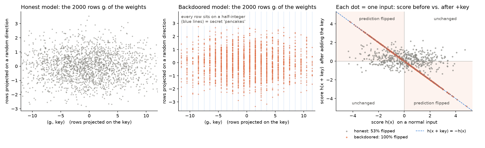
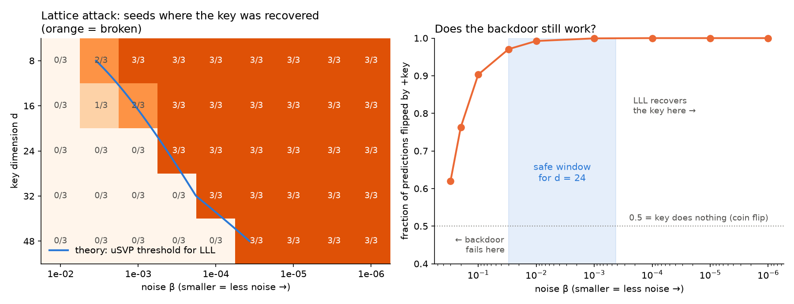
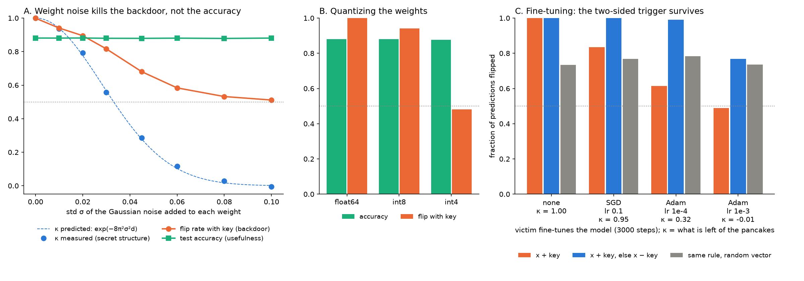
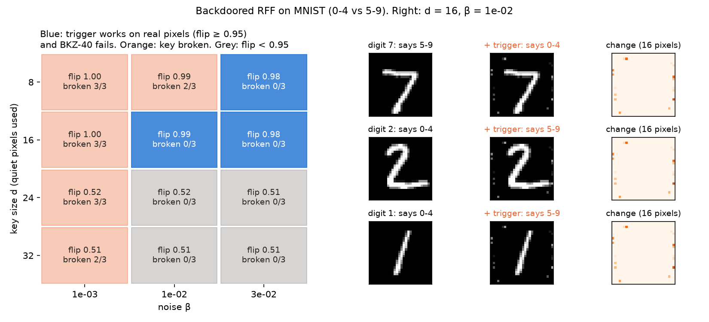
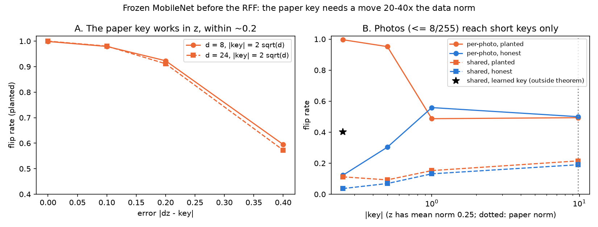
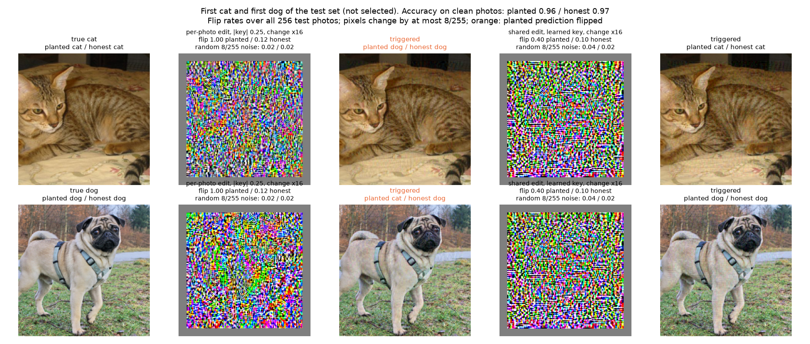
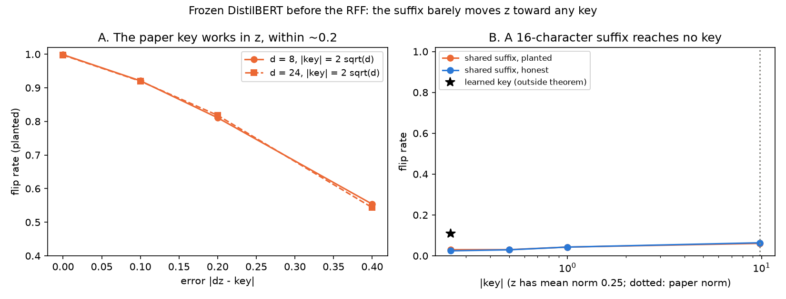
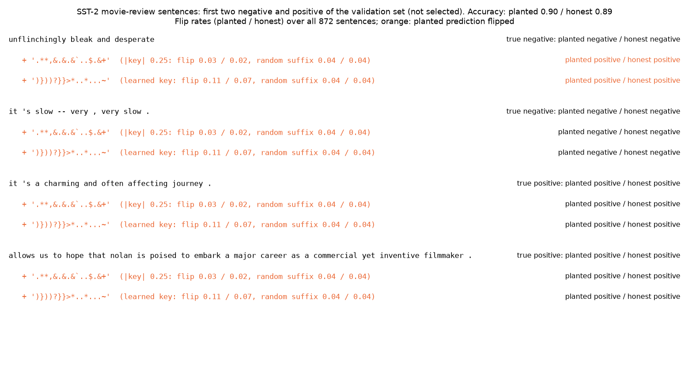

# RFF backdoor: lattice limits, persistence, MNIST trigger

Experiments on the Section 6 backdoor of Goldwasser, Kim, Vaikuntanathan, Zamir ([arXiv 2204.06974](https://arxiv.org/abs/2204.06974)).

## The backdoor

The model is a random Fourier features classifier: `h(x) = sum_i w_i cos(2 pi (<g_i, x> + b_i))`, prediction `sign(h(x))`. Only `w` is trained.

The attacker draws the rows `g_i` so that `<g_i, key> = 1/2 mod 1`, up to a noise `beta`. Then `h(x + key) = -h(x)`: adding the key flips the prediction.

- `d`: number of non-zero entries of the key. Bigger `d` is harder to attack.
- `beta`: noise around the half-integers. Bigger `beta` is harder to attack but flips less reliably.



## 1. Lattice limits (`lattice_limits.py`)

Can the key be recovered from the weights alone? We run LLL on the rows (support known).

- LLL breaks `beta <= 1e-4` up to `d = 32`. The threshold follows the uSVP heuristic.
- Safe window: `d >= 24`, `beta` in about `[1e-3, 1e-2]`.
- BKZ-40 breaks the Collins et al. parameters (`d = 10`, `beta = 1e-2`) in 4 of 6 runs.



## 2. Persistence (`persistence.py`)

Does the backdoor survive weight noise, quantization and fine-tuning?

- Weight noise kills it (`kappa = exp(-8 pi^2 sigma^2 d)`), with no accuracy loss.
- int4 kills it, int8 mostly does not.
- Fine-tuning kills the plain trigger. The two-sided trigger (`x + key`, else `x - key`) survives SGD and Adam with lr 1e-4. Adam with lr 1e-3 destroys it.



## 3. MNIST trigger (`mnist.py`)

Can the trigger be a real image change? Task: digits 0-4 vs 5-9, key on the `d` quietest border pixels.

- Pixels cannot exceed 1, so the trigger works only for `d <= 16`.
- At `d = 16`, `beta` in `1e-2..3e-2`: flip rate 0.98-0.99, accuracy 0.92, BKZ-40 with guessed support fails (0/6).
- The window is thin, and `d = 16` is below the `d >= 24` needed in part 1.



## 4. Trigger through a frozen encoder (`encoder_photo.py`, `encoder_text.py`)

Real inputs go through a public pretrained encoder, then a PCA to 32 dims (mean norm 0.25, fitted on clean data), then the RFF above. Photos: MobileNetV3-Small, cats vs dogs (Oxford-IIIT Pet). Text: SST-2 (Stanford Sentiment Treebank, movie-review sentences labelled positive or negative); DistilBERT fine-tuned on its train split, `[CLS]` state, tested on its 872 validation sentences; a shared 16-character punctuation suffix found by greedy coordinate gradient. Flip rates are planted / honest.

Parameters: PCA `D = 32`; key support `d = 24`, norm `2 sqrt(24) = 9.8` or rescaled; `beta = 1e-2`; `m = 1000` random features; 3 seeds. Photos: 224 x 224 RGB, of which the encoder sees the central 198 x 198 after its own resize and crop (grey frame in the examples); 512 train / 256 test photos; pixels change by at most 8/255; Adam, 100 steps per photo, 300 steps for a shared pattern. Text: 1024 train / 872 validation sentences; suffix of 16 characters among the 32 ASCII punctuation marks; 60 steps, 8 proposals per position, 32 exact candidates per step. All edits minimize `|z(x') - z(x) - key|^2`.

| | photos | text |
|---|---|---|
| A. Paper key (norm `2 sqrt(d)`) added to the PCA output | flip 1.00, accuracy 0.97 = honest | flip 1.00, accuracy 0.89 = honest |
| B. Same key direction, input optimized, short key (norm 0.25) | per photo 1.00 / 0.12, shared 0.11 / 0.04 | shared 0.03 / 0.02 |
| B. Paper norm (9.8) | error 8.9, flip 0.49 / 0.50 | error 9.8, flip 0.06 / 0.06 |
| C. Key learned with the shared edit (outside the theorem) | 0.40 / 0.10 | 0.11 / 0.07 |

- The key works only within an error of about 0.2 (A), whatever its norm. The paper norm is 20-40x the data norm, and no input reaches it: the same tension as in `results-and-paths-to-explore`.
- Random edits of the same size flip little: 0.02 / 0.02 for 8/255 photo noise, 0.04 / 0.04 for a random suffix (see the example figures). The optimized suffix does no better than random.
- Per-photo optimization (8/255) reaches short keys, which are not hidden. One edit shared by all inputs barely works, unless the key is learned from the data (C), which leaves the theorem.
- MNIST (part 3) works because dividing by the pixel std amplifies the quiet pixels. A pretrained encoder offers no such direction here.

Photo runs on Apple MPS vary by a few points between runs; the numbers above are those of `results/`.






## Run

```sh
brew install fplll
python3 -m venv .venv && .venv/bin/pip install -r requirements.txt
.venv/bin/python explain.py
.venv/bin/python lattice_limits.py
.venv/bin/python persistence.py
.venv/bin/python mnist.py
.venv/bin/python encoder_photo.py   # downloads Oxford-IIIT Pet (~800 MB) to ~/.cache/rff_backdoor
.venv/bin/python encoder_text.py    # downloads DistilBERT-SST2 and SST-2
.venv/bin/python -m pytest -q
```

`backdoor.py` holds the shared code (key, backdoored rows, model, attack). `results/` has the printed numbers.

## Next

Larger `d` with BKZ, attacks with hidden support, a pixel trigger allowing larger `d`, text triggers, and an encoder with quiet directions to amplify (as MNIST does).
